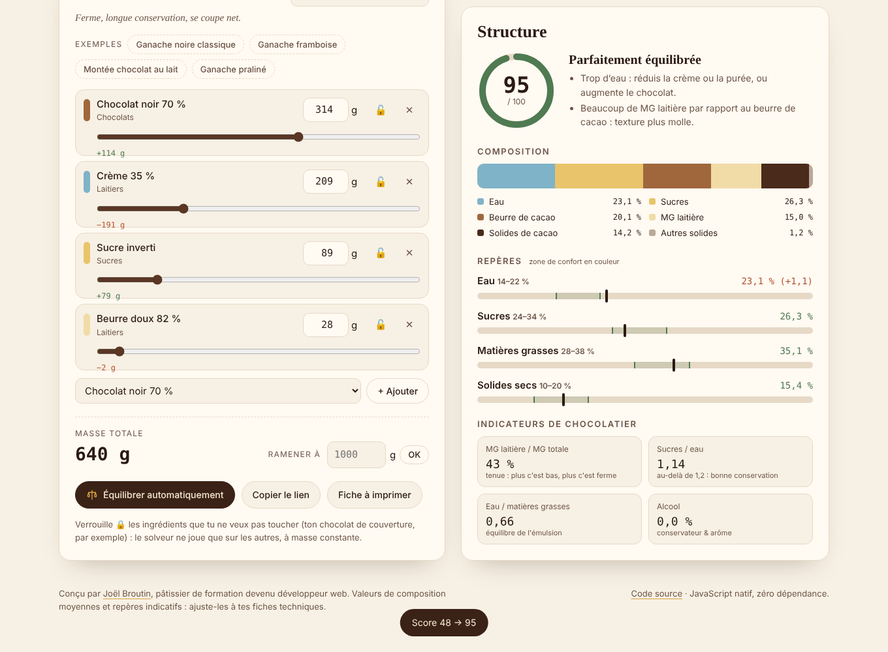

# Équilibre — atelier de formulation de ganaches

> Pâtissier de formation devenu développeur web, j'ai codé l'outil que j'aurais voulu avoir au labo.

**[▶ Démo en ligne](https://as9ardth0r.github.io/equilibre-ganache/)**



Une ganache est une émulsion : de l'eau, des sucres, des matières grasses et des solides qui doivent tenir ensemble. Trop d'eau, elle moisit ; trop de gras, elle suinte ; pas assez de sucres, elle ne se conserve pas.
**Équilibre** calcule la structure d'une recette en temps réel, la compare aux repères du métier et la **rééquilibre automatiquement**.

## Fonctionnalités

- **Analyse en direct** : composition détaillée (eau, sucres, beurre de cacao, MG laitière, solides de cacao…) recalculée à chaque gramme.
- **Trois profils** : ganache à cadrer (bonbon), ganache tarte/entremets, ganache montée, chacun avec sa zone de confort.
- **Équilibrage automatique** : un solveur (descente de gradient projetée) ajuste les quantités pour entrer dans les zones cibles, **à masse constante**, en restant proche de la recette de départ.
- **Verrouillage** des ingrédients à ne pas toucher (« je garde mes 300 g de couverture »).
- **Conseils de chef** générés à partir des écarts (« trop d'eau : réduis la crème… »).
- **Indicateurs de chocolatier** : part de MG laitière, rapport sucres/eau, rapport eau/MG.
- **Partage par lien** : la recette entière tient dans l'URL, sans base de données.
- **Fiche imprimable**, mise à l'échelle (« ramène à 1 kg »), mode sombre automatique, responsive et accessible (navigation clavier, `prefers-reduced-motion`).

## Sous le capot

| | |
|---|---|
| Stack | HTML, CSS et JavaScript natif (modules ES) : **zéro dépendance, zéro build** |
| Architecture | moteur de calcul pur (`js/engine.js`) séparé de l'interface (`js/app.js`) |
| Algorithme | minimisation des écarts hors zone + attraction vers le centre de la zone + régularisation vers la recette initiale, avec projection euclidienne sur le simplexe (Duchi et al., 2008) pour garantir des quantités positives et une masse totale fixe |
| Tests | `node --test` : conservation de la masse, projection, amélioration du score, respect des verrous, partage d'URL |
| Hébergement | GitHub Pages |

```
equilibre-ganache/
├── index.html
├── css/styles.css
├── js/
│   ├── data.js     # ingrédients, profils cibles, recettes d'exemple
│   ├── engine.js   # composition, diagnostic, solveur (sans DOM)
│   └── app.js      # interface et animations
└── tests/engine.test.mjs
```

## Lancer en local

```bash
git clone https://github.com/as9ardth0r/equilibre-ganache.git
cd equilibre-ganache
python3 -m http.server 8000   # puis http://localhost:8000
npm test                      # Node 18+
```

## Limites

Les compositions sont des moyennes de fiches techniques et les zones cibles sont des repères indicatifs. Elles ne remplacent ni tes propres fiches produits ni une mesure d'activité de l'eau (Aw) en laboratoire. Le fichier `js/data.js` est fait pour être adapté.

## Auteur

**Joël Broutin**, développeur web freelance à Wimereux.
[Portfolio](https://as9ardth0r.github.io/portfolio/) · Disponible pour vos sites et applications web.

Licence MIT.
